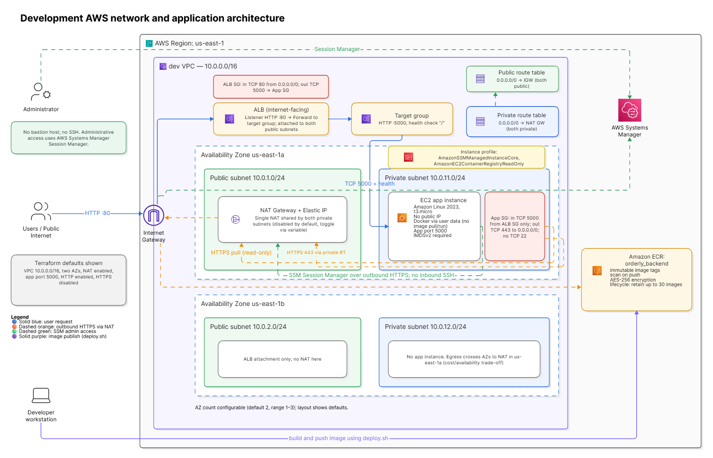

# Cloud & DevOps Portfolio

Hands-on cloud and DevOps projects by **Muhammed Rameez**, a software developer
(React, Node.js, MongoDB) transitioning into Cloud/DevOps engineering.
Each project is built, deployed, automated and documented end to end.

> **Status:** 🚧 Work in progress. Updated regularly as I build.

## 🎯 Goal

Show that I can take an application from code to production on Cloud (AWS) using
infrastructure as code, CI/CD, containers and monitoring, and explain the
design decisions behind it.

## 📁 Repository structure

```
cloud-devops-portfolio/
├── app/     # Application source code (MERN stack)
├── infra/   # Infrastructure as Code (Terraform), scripts, configs
├── docs/    # Architecture diagrams, design decisions, runbooks, screenshots
└── README.md
```

## 🧱 Tech stack

| Area       | Tools                                         |
| ---------- | --------------------------------------------- |
| Cloud      | AWS (EC2, S3, IAM, VPC, RDS, ALB, CloudWatch) |
| IaC        | Terraform                                     |
| CI/CD      | GitHub Actions                                |
| Containers | Docker _(Kubernetes/EKS planned)_             |
| Monitoring | CloudWatch _(Prometheus/Grafana planned)_     |
| App        | React, Node.js, MongoDB                       |

_Only items I have actually used are marked as done in the roadmap below._

## 🗺️ Roadmap

- [x] Containerize the MERN app with Docker
- [x] Deploy backend on AWS: EC2 + ALB + ECR
- [ ] Frontend on S3/CloudFront
- [ ] Managed DB
- [ ] Rebuild the infrastructure with Terraform
- [ ] Add a CI/CD pipeline with GitHub Actions
- [ ] Add monitoring and alerting
- [ ] Add architecture diagrams and write-ups in `/docs`
- [ ] Migrate to Kubernetes (EKS)

## 🏗️ Architecture

   
_Reference VPC design: 2 public and 2 private subnets across 2 AZs, with optional NAT._

## 🚀 Getting started

_Setup and deployment instructions will be added as each component is completed._

```bash
# Example (to be updated)
git clone git@github.com:rameezrz/cloud-devops-portfolio.git
cd cloud-devops-portfolio
```

## 📝 Lessons learned

_I'll document problems I hit and how I solved them here and in `/docs`._

## 🔒 Security note

No secrets, credentials or state files are committed to this repo
(see `.gitignore`).

## 📫 Contact

[LinkedIn](https://www.linkedin.com/in/rzeee) · [Email](mailto:rameez007rz@gmail.com) · [GitHub Profile](https://github.com/rameezrz)
